# Hüseyin Baydemir

**Digital Experience Architect**

> Bir şeyin nasıl çalıştığını anlamak, onu kullanmak kadar ilgimi çekiyor.

[baydemir.net ↗](https://baydemir.net) · [Baydemir Artifacts ↗](https://artifacts.baydemir.net/) · [huseyin@baydemir.net](mailto:huseyin@baydemir.net)

## Teknolojiler

