# Hüseyin Baydemir

**Digital Experience Architect**

> Bir şeyin nasıl çalıştığını anlamak, onu kullanmak kadar ilgimi çekiyor.

[baydemir.net ↗](https://baydemir.net) · [Baydemir Artifacts ↗](https://artifacts.baydemir.net/) · [huseyin@baydemir.net](mailto:huseyin@baydemir.net)

## Projeler

- **[axios-request](https://github.com/hbaydemir/axios-request)** · JavaScript’te Axios ile HTTP istekleri.
- **[algortihms](https://github.com/hbaydemir/algortihms)** · Sıralama algoritmaları ve ikili arama ağacı alıştırmaları.

## Teknolojiler

- **Web** · JavaScript, React, Redux, HTML, CSS, Sass, Bootstrap, jQuery
- **Backend** · Node.js, PHP, Laravel
- **Veri** · PostgreSQL, MySQL, MongoDB
