I’m **Hüseyin Baydemir**. I build web apps, tools and side projects with JavaScript, React and Node.js.

[Website](https://hbaydemir.com) · [Socials](https://linktr.ee/hbaydemir) · [Email](mailto:info@hbaydemir.com)

## ◆ Level select

<code>LEVEL 01</code> &nbsp; <strong>axios-request</strong>

A JavaScript repository for working with Axios requests.

[Open repository ↗](https://github.com/hbaydemir/axios-request)

<code>LEVEL 02</code> &nbsp; <strong>algortihms</strong>

A collection of algorithm practice exercises.

[Open repository ↗](https://github.com/hbaydemir/algortihms)

<code>LOADOUT</code> &nbsp; <strong>Tools &amp; technologies</strong>

- **Web** · HTML, CSS, Sass, Bootstrap, JavaScript, React, Redux, jQuery
- **Backend** · Node.js, PHP, Laravel
- **Data** · PostgreSQL, MySQL, MongoDB

